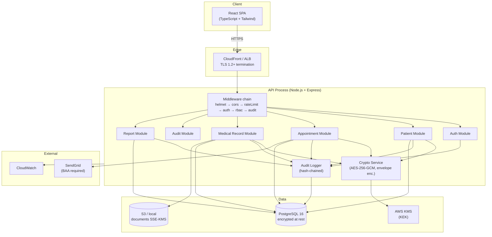
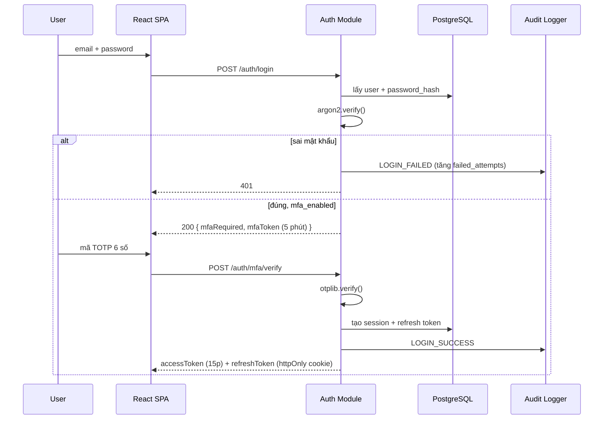
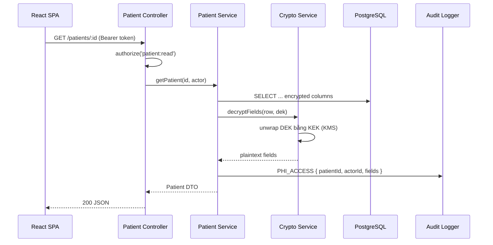

# 02 · Kiến Trúc Hệ Thống

## Tổng quan

Kiến trúc **modular monolith**: một tiến trình Node.js duy nhất, chia thành các module theo domain, giao tiếp qua service layer. Với 20 người dùng, microservices là over-engineering — nhưng ranh giới module được giữ rõ để tách sau nếu cần.



## Phân lớp (layered)

```
routes/       Định nghĩa HTTP endpoint, gắn middleware, không chứa business logic
  ↓
controllers/  Parse + validate request (Zod), gọi service, format response
  ↓
services/     Business logic, transaction boundary, gọi crypto + audit
  ↓
repositories/ Truy vấn DB (Kysely), không biết gì về HTTP
  ↓
db/           Connection pool, migrations, generated types
```

Quy tắc: lớp trên chỉ gọi lớp ngay dưới. Không có repository nào gọi service.

## Middleware chain (thứ tự bắt buộc)

| # | Middleware | Vai trò |
|---|---|---|
| 1 | `requestId` | Gán UUID cho mỗi request, dùng xuyên suốt log + audit |
| 2 | `helmet` | Security headers (HSTS, CSP, noSniff) |
| 3 | `cors` | Allowlist origin cụ thể, không dùng `*` |
| 4 | `express.json({ limit })` | Giới hạn body 1MB (upload đi route riêng) |
| 5 | `httpLogger` (pino) | Log request, **redact** field PHI |
| 6 | `rateLimit` | Global 100 req/15min; `/auth/login` 5 req/15min |
| 7 | `authenticate` | Verify JWT, nạp `req.user` |
| 8 | `enforceSessionTimeout` | Kiểm tra idle 30 phút |
| 9 | `authorize(permission)` | RBAC theo permission |
| 10 | `auditAccess` | Ghi audit log sau khi response hoàn tất |
| 11 | `errorHandler` | Chuẩn hoá lỗi, **không leak** stack/PHI ra client |

## Luồng nghiệp vụ chính

### Đăng nhập có MFA



### Đọc hồ sơ bệnh nhân (giải mã)



## Ranh giới module

| Module | Sở hữu bảng | Phụ thuộc |
|---|---|---|
| auth | `users`, `sessions`, `refresh_tokens`, `mfa_secrets` | crypto, audit |
| patient | `patients`, `patient_contacts`, `patient_allergies`, `patient_medical_history`, `patient_consents` | crypto, audit |
| appointment | `appointments`, `appointment_notes`, `waitlist` | patient (read-only), audit |
| medical-record | `medical_records`, `prescriptions`, `lab_results`, `documents` | patient (read-only), crypto, audit |
| audit | `audit_logs`, `phi_access_logs` | — (không phụ thuộc module nào) |
| report | đọc từ view, không sở hữu bảng | patient, appointment, audit |

## Nguyên tắc bất biến

1. **Mọi truy cập PHI phải ghi audit log** — không có đường tắt, kể cả admin.
2. **Không log PHI vào application log** — pino redact list bắt buộc.
3. **Không trả stack trace ra client** ở bất kỳ môi trường nào.
4. **Mọi mutation chạy trong transaction** cùng với audit log entry.
5. **Frontend không bao giờ giữ khoá giải mã** — kiến trúc là server-side field encryption.
