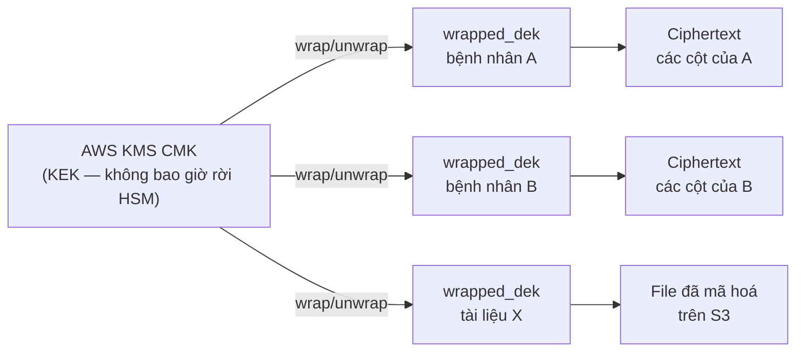

# 06 · Kiến Trúc Bảo Mật & Ánh Xạ HIPAA

## 1. Mô hình mã hoá

### Quyết định: field-level encryption phía server, KHÔNG phải E2E client-side

Spec gốc ghi "mã hoá end-to-end". Cần nói rõ: **E2E thật** (chỉ client giữ khoá) sẽ làm server không thể tìm kiếm, báo cáo, gửi nhắc lịch, hay khôi phục dữ liệu khi người dùng mất khoá — không khả thi cho CRM y tế đa người dùng.

Mô hình đã chọn:

```
Layer 1 — Transit:  TLS 1.2+ (client ↔ server, server ↔ RDS)
Layer 2 — Field:    AES-256-GCM, DEK riêng mỗi bệnh nhân
Layer 3 — At rest:  RDS storage encryption (AES-256, KMS)
Layer 4 — Backup:   Snapshot mã hoá bằng cùng KMS key
```

Thuật toán: **AES-256-GCM** qua `node:crypto`. Đây là thuật toán được NIST phê
duyệt (FIPS 140-2) mà hướng dẫn "encryption safe harbor" của HHS tham chiếu tới
(NIST SP 800-111) — dùng nó nghĩa là nếu ciphertext bị lộ mà khoá vẫn an toàn thì
không cấu thành breach phải thông báo. GCM là chế độ AEAD nên cho cả tính bí mật
lẫn tính toàn vẹn trong một bước.

### Phân cấp khoá (envelope encryption)



- **DEK** (32 byte) sinh ngẫu nhiên cho mỗi bệnh nhân / mỗi file, chỉ nằm trong RAM khi đang dùng, gọi `zeroize()` sau đó.
- **KEK** ở KMS (prod). Dev dùng khoá trong `.env` — chỉ hợp lệ với dữ liệu giả.
- Ciphertext layout: `[version:1][iv:12][authTag:16][ciphertext]`. Version byte cho phép xoay thuật toán sau này.
- IV sinh ngẫu nhiên mỗi lần mã hoá — cùng plaintext cho ra ciphertext khác nhau (đã có test kiểm chứng).

### Tìm kiếm trên dữ liệu mã hoá

`searchHash()` = HMAC-SHA256 của giá trị đã chuẩn hoá (bỏ dấu tiếng Việt, lowercase, gộp khoảng trắng). Khoá HMAC (`SEARCH_HMAC_KEY`) **tách biệt** với KEK — lộ một cái không kéo theo cái kia.

Hạn chế đã biết: chỉ hỗ trợ khớp chính xác, và về lý thuyết cho phép tấn công phân tích tần suất nếu kẻ tấn công đã có DB dump. Chấp nhận được vì DB dump đã là sự cố nghiêm trọng hơn nhiều.

### Crypto-shredding
Xoá `wrapped_dek` = ciphertext vĩnh viễn không giải mã được, kể cả trong backup cũ. Đây là cách hiện thực "secure deletion" (§164.310(d)(2)(i)) mà không cần ghi đè từng byte.

## 2. Xác thực & phiên

| Kiểm soát | Cấu hình | Điều khoản HIPAA |
|---|---|---|
| Password hashing | Argon2id, 19 MiB, t=2, p=1 | §164.312(d) |
| Độ dài mật khẩu tối thiểu | 12 ký tự, kiểm tra danh sách rò rỉ | §164.308(a)(5)(ii)(D) |
| MFA | TOTP RFC 6238, cửa sổ ±30s, bắt buộc cho mọi role | §164.312(d) |
| Recovery codes | 10 mã, hash SHA-256, dùng một lần | — |
| Access token | JWT HS256, TTL 15 phút | §164.312(a)(2)(i) |
| Refresh token | Opaque 32 byte, lưu hash SHA-256 trong DB, httpOnly + Secure + SameSite=Strict | — |
| Idle timeout | 30 phút → thu hồi session | §164.312(a)(2)(iii) |
| Account lockout | 5 lần sai → khoá 15 phút | §164.308(a)(5)(ii)(C) |

**Không dùng SMS OTP**: SMS không đạt AAL2 theo NIST SP 800-63B (dễ bị SIM swap).

## 3. Kiểm soát truy cập

Ba tầng, kiểm tra tuần tự:

1. **Xác thực** — token hợp lệ, session sống, chưa idle timeout.
2. **RBAC** — permission theo role (bảng `role_permissions`).
3. **Ràng buộc theo bản ghi** (Phase 2) — bác sĩ chỉ xem hồ sơ bệnh nhân mình phụ trách, trừ khi kích hoạt "break-glass" (truy cập khẩn cấp có ghi log và cảnh báo ngay).

Nguyên tắc least privilege đã áp dụng: role `auditor` xem được toàn bộ audit log nhưng **không** có `patient:read`.

## 4. Audit & toàn vẹn

| Yêu cầu | Cách hiện thực |
|---|---|
| Ghi mọi truy cập | Middleware `auditAccess` + `writePhiAccessLog()` trong service layer |
| Ai / Cái gì / Khi nào / Kết quả | `actor_id`, `action` + `entity_*`, `created_at`, `outcome` |
| Không thể xoá | Trigger DB `reject_audit_mutation` chặn UPDATE/DELETE; role app bị REVOKE |
| Phát hiện giả mạo | Hash chain `entry_hash = SHA256(prev_hash ‖ canonical_json)`; job kiểm tra hằng ngày |
| Giữ 6 năm | Partition theo tháng, archive S3 Glacier sau 2 năm |
| Cảnh báo bất thường | Phase 3: ngưỡng cho truy cập hàng loạt, truy cập ngoài giờ, dò MRN |

Audit log ghi **trong cùng transaction** với thao tác nghiệp vụ — không có trường hợp nghiệp vụ thành công mà audit thất bại.

## 5. Chống lộ PHI qua đường phụ

| Kênh rò rỉ | Biện pháp |
|---|---|
| Application log | pino `redact` list bắt buộc (`config/logger.ts`) |
| Thông báo lỗi | `errorHandler` không bao giờ trả stack/lỗi DB thô |
| URL / query string | ID bệnh nhân dùng UUID, không đưa tên/dob lên URL |
| Audit log `changes` | Chỉ ghi tên trường thay đổi, không ghi giá trị PHI plaintext |
| Trình duyệt | `Cache-Control: no-store` cho mọi response chứa PHI |
| Git | `.gitignore` chặn `*.dump`, `patient-export*`, `phi-*` |

## 6. Threat model (STRIDE rút gọn)

| # | Mối đe doạ | Loại | Giảm thiểu | Còn lại |
|---|---|---|---|---|
| T1 | Đánh cắp credential nhân viên | Spoofing | MFA bắt buộc, lockout, cảnh báo đăng nhập lạ | Phishing MFA real-time |
| T2 | Nhân viên nội bộ xem trộm hồ sơ | Info disclosure | RBAC, PHI access log, cảnh báo truy cập bất thường | Không chặn được truy cập hợp lệ bị lạm dụng |
| T3 | SQL injection | Tampering | Kysely parameterized query, không nối chuỗi SQL | — |
| T4 | XSS đánh cắp token | Info disclosure | Access token chỉ trong RAM, refresh trong httpOnly cookie, CSP | — |
| T5 | Đánh cắp DB dump | Info disclosure | Field encryption + DEK ở KMS | Phân tích tần suất trên search hash |
| T6 | Sửa/xoá audit log | Repudiation | Trigger append-only, hash chain, REVOKE quyền | Kẻ tấn công có quyền superuser DB |
| T7 | CSRF | Tampering | SameSite=Strict, CORS allowlist, không dùng cookie cho access token | — |
| T8 | Brute-force login | Elevation | Rate limit 5/15 phút trên `/auth/login`, lockout | — |
| T9 | Lộ khoá trong .env | Info disclosure | Prod bắt buộc KMS (`env.ts` chặn khởi động nếu `local`) | Rủi ro ở dev |
| T10 | Dependency bị chèn mã độc | Tampering | `npm audit` trong CI, lockfile commit, Dependabot | Supply chain zero-day |

## 7. Ánh xạ HIPAA Security Rule

### Administrative Safeguards §164.308

| Điều khoản | Yêu cầu | Trạng thái |
|---|---|---|
| (a)(1)(ii)(A) | Risk analysis | ⏳ Threat model mục 6 là bản nháp; đánh giá chính thức ở Phase 3 |
| (a)(1)(ii)(D) | Information system activity review | ✅ Audit log + dashboard (Phase 3) |
| (a)(3) | Workforce security | ⏳ Chính sách nhân sự — Phase 3 |
| (a)(4) | Information access management | ✅ RBAC seed sẵn |
| (a)(5) | Security awareness training | ⏳ Phase 5 |
| (a)(6) | Security incident procedures | ⏳ Phase 3 |
| (a)(7) | Contingency plan | ⏳ Backup/DR — Phase 3 |
| (b)(1) | Business Associate contracts | ❌ **Chưa ký BAA với AWS/SendGrid — blocker cho go-live** |

### Physical Safeguards §164.310

| Điều khoản | Trạng thái |
|---|---|
| (a)(1) Facility access | ✅ Uỷ thác cho AWS (SOC 2 / HIPAA eligible) |
| (d)(2)(i) Disposal | ✅ Crypto-shredding |
| (d)(2)(ii) Media re-use | ✅ EBS/S3 mã hoá, AWS xử lý |

### Technical Safeguards §164.312

| Điều khoản | Yêu cầu | Trạng thái |
|---|---|---|
| (a)(1) | Access control | ✅ RBAC + authenticate middleware |
| (a)(2)(i) | Unique user ID | ✅ UUID mỗi user, cấm tài khoản dùng chung |
| (a)(2)(ii) | Emergency access | ⏳ Break-glass — Phase 2 |
| (a)(2)(iii) | Automatic logoff | ✅ Idle timeout 30 phút |
| (a)(2)(iv) | Encryption/decryption | ✅ Field-level + at rest |
| (b) | Audit controls | ✅ audit_logs + phi_access_logs |
| (c)(1) | Integrity | ✅ Hash chain + trigger append-only |
| (d) | Person authentication | ✅ Argon2id + TOTP MFA |
| (e)(1) | Transmission security | ✅ TLS 1.2+, HSTS |

Chú thích: ✅ đã hiện thực ở Phase 1 · ⏳ đã lên kế hoạch · ❌ blocker

## 8. Việc phải làm trước khi có PHI thật

1. Ký BAA với AWS và SendGrid.
2. Chuyển `KEK_PROVIDER` sang `aws-kms`, xoay toàn bộ khoá dev.
3. Bật RDS encryption at rest + automated backup + PITR.
4. Chạy security audit và penetration test (Phase 4).
5. Hoàn thiện bộ chính sách: Information Security, Privacy, Incident Response, Acceptable Use.
6. Đào tạo bảo mật cho toàn bộ 20 người dùng, có ký xác nhận.
